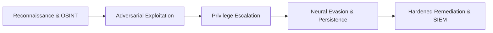

<div align="center">

```
  ████████╗     ██████╗ ███████╗██╗  ██╗
  ╚══██╔══╝     ██╔══██╗██╔════╝╚██╗██╔╝
     ██║  █████╗██████╔╝█████╗   ╚███╔╝ 
     ██║  ╚════╝██╔══██╗██╔══╝   ██╔██╗ 
     ██║        ██║  ██║███████╗██╔╝ ██╗
     ╚═╝        ╚═╝  ╚═╝╚══════╝╚═╝  ╚═╝
```

# ⚡ It's TAWHIDUR
### Senior Cyber Security Engineer • Red Team Operator • Adversarial AI Researcher

[](https://www.linkedin.com/in/tawhidur-rahman-0b3218381/)

[](https://www.linkedin.com/in/tawhidur-rahman-0b3218381/)
[](https://maps.google.com)

<p align="center">
  
  
  
</p>

---

> *"Weaponizing intelligence, engineering deterministic defenses, and exposing theoretical zero-days before malicious actors strike."*

</div>

## 📌 Executive Summary

Lead Penetration Tester and Security Researcher with verified critical findings (**CVSS 9.8**) across enterprise telecom gateways, banking integration pipelines, and academic infrastructures. Proven experience heading security engineering operations, conducting full-scope red teaming, architecting real-time SIEM/IDS platforms, and developing adversarial AI research on Apple Silicon.

- 🏆 **1st Place Champion**: Department of Software Engineering (DIU) AI Project Showcase with **ThreatVision**.
- 🛡️ **National Telecom Pentest Lead**: Identified negative-amount bypasses & critical flaws across bKash, Nagad, Rocket & SSL-Commerz integrations.
- 🎖️ Former **Head of Cyber Security Architecture & Admin** at **BOTbari**.
- 🔬 **Published Thesis**: *"T-WORM: Advanced Offensive Large Language Models — Engineering Uncensored Neural Primitives on Apple Silicon"* (Jan 2026).

---

## 💻 Dynamic GitHub Telemetry

<div align="center">
  
  
</div>

<div align="center">
  
</div>

---

## 🛠️ The Defensive & Offensive Arsenal



### 🎯 Security Testing & Red Teaming


### 💻 Programming & System Development


### 🤖 AI Engineering & Adversarial ML


---

## 🔥 Featured Production Repositories

<table>
  <tr>
    <td width="50%">
      <h3 align="center"><a href="https://github.com/robat699-cmyk/Threatvision">🛡️ Threatvision // IDS Sentinel</a></h3>
      <p align="center"><b>1st Place AI Competition Winner</b></p>
      <p>Tactical Cyber Reconnaissance, Autonomous Intrusion Detection & AI Neural Mitigation Platform. Ingests live telemetry, models geo-threat vectors, and triggers automated firewall mitigations.</p>
      <p align="center">
        <code>React</code> • <code>TypeScript</code> • <code>Node.js</code> • <code>AI Forensics</code> • <code>Express</code>
      </p>
    </td>
    <td width="50%">
      <h3 align="center"><a href="https://github.com/robat699-cmyk/Crackrex">⚡ Crackrex // Red Teaming Matrix</a></h3>
      <p align="center"><b>AI Adversarial Evasion Framework</b></p>
      <p>Autonomous security testing framework to stress-test modern AI models, Android 17+ isolation sandboxes, and behavioral AV/EDR heuristic detection engines using payload mutation.</p>
      <p align="center">
        <code>TypeScript</code> • <code>Vite</code> • <code>Red Team</code> • <code>Adversarial ML</code> • <code>Tailwind</code>
      </p>
    </td>
  </tr>
  <tr>
    <td width="50%">
      <h3 align="center"><a href="https://github.com/robat699-cmyk/Rankrush">🚀 Rankrush // SEO Intelligence</a></h3>
      <p align="center"><b>High-Performance Semrush Alternative</b></p>
      <p>Full-stack competitor SERP rank tracking, headless backlink scraping pipeline, technical health checks, and automated AI on-page audit recommendations.</p>
      <p align="center">
        <code>Node.js</code> • <code>Puppeteer</code> • <code>Cheerio</code> • <code>Google GenAI</code> • <code>TypeScript</code>
      </p>
    </td>
    <td width="50%">
      <h3 align="center"><a href="https://github.com/robat699-cmyk/CareerGate">💼 CareerGate // Talent Marketplace</a></h3>
      <p align="center"><b>AI-Powered ATS & Recruitment Engine</b></p>
      <p>Full-lifecycle job ecosystem integrating candidate career tools with automated AI resume parsing, candidate scoring pipelines, role-based workflows, and Stripe subscriptions.</p>
      <p align="center">
        <code>React</code> • <code>TypeScript</code> • <code>Firebase Firestore</code> • <code>Stripe API</code> • <code>Gemini AI</code>
      </p>
    </td>
  </tr>
</table>

---

## 📈 Activity & Security Research Contributions

<div align="center">
  
</div>

---

<div align="center">
  <p>💼 <b>Currently considering select Offensive Security, AppSec & Threat Research roles.</b></p>
  <a href="https://www.linkedin.com/in/tawhidur-rahman-0b3218381/">
    
  </a>
</div>
